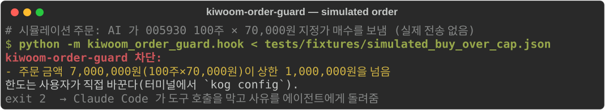

<div align="center">

<picture>
  <source media="(prefers-color-scheme: dark)" srcset="docs/images/brand/wordmark-dark.svg">
  
</picture>

# kiwoom-order-guard

**AI 에이전트가 키움 공식 MCP·플러그인으로 내는 주문의 *내용*을 전송 전에 검사하는 Claude Code 훅**

공식 도구는 "사람이 확인했나"를 봅니다. 이 훅은 "확인할 만한 주문인가"를 봅니다.

[](https://github.com/younghwan91/kiwoom-order-guard/actions/workflows/ci.yml)
[](https://www.python.org/downloads/)
[](LICENSE)
[](https://www.linkedin.com/in/younghwan-chae/)

[빠른 시작](#빠른-시작) · [상세 가이드](docs/guide.md) · [원장 구조](docs/ledger.md) · [kiwoom-client](https://github.com/younghwan91/kiwoom-client) · [English](README.en.md)

</div>

<p align="center">
  
</p>

<p align="center"><sub><b>시뮬레이션 주문</b>(키·계좌·전송 없음) — 1건 상한 100만원을 넘는 700만원 매수를 훅이 실제로 막은 출력입니다. 입력은 <code>tests/fixtures/simulated_buy_over_cap.json</code>.</sub></p>

```bash
# 이 화면을 직접 다시 만드는 명령(레포 루트에서)
uv run --no-project --python 3.13 --with rich python scripts/demo.py
```

## 빠른 시작

Claude Code에서 플러그인을 설치합니다.

```text
/plugin marketplace add younghwan91/kiwoom-order-guard
/plugin install kiwoom-order-guard@kiwoom-order-guard
```

한도는 **사용자가 직접** 터미널에서 초기화하고 확인합니다.

```bash
uvx --from git+https://github.com/younghwan91/kiwoom-order-guard kog init     # 기본 설정 파일 생성
uvx --from git+https://github.com/younghwan91/kiwoom-order-guard kog config   # 설정 위치·내용 확인
```

- **설정 위치**: Linux·macOS `~/.config/kiwoom-order-guard/config.toml`, Windows `%APPDATA%\kiwoom-order-guard\config.toml`입니다.
- **오타·누락 방어**: 모르는 키나 형식이 틀린 값이 있거나, `kog init` 이후 설정 파일이 사라지면 매수·정정 주문을 막습니다.

## 주요 기능

- **주문 내용 직접 검증**: 1건 금액·수량 상한, 시장가 매수 차단, 120초 중복 매수 차단, 일일/종목당 횟수 제한을 전송 전에 강제합니다.
- **우회 방지 구조 파싱**: 실행 파일 이름이 아니라 명령 구조(`orders … --confirm`, `order-preview`, MCP `kiwoom_order_submit`)를 파싱하고, 변수·반복문·스크립트 작성 등 해석할 수 없는 주문을 차단합니다.
- **제로 의존성 · 45ms 기동**: Python 3.11+ 표준 라이브러리만 사용하며, `uv` 기반 훅으로 Bash/MCP 호출당 ~90ms(전/후 훅)로 동작합니다.
- **사람 중심 통제**: 한도 설정(`kog init`, `kog config`)과 비상정지 해제(`kog resume`)는 터미널에서 사용자만 수행할 수 있으며, 에이전트의 설정 변경 시도는 차단합니다.

## 검사 규칙과 기본값

| 검사 | 기본값 | 대상 |
|---|---|---|
| 1건 금액 상한 | 국내 100만원 / 해외 $1,000 | 신규 매수, 국내 정정 |
| 1건 수량 상한 | 1,000주 | 신규 매수, 국내 정정 |
| 시장가류 매수 (금액을 미리 모름) | 차단 | 신규 매수 |
| 같은 매수 반복 (에이전트 재시도 루프) | 120초 동안 차단 | 신규 매수 |
| 하루 / 종목당 매수 시도 | 20건 / 5건 | 신규 매수 |
| 허용 목록 (비어 있지 않을 때) | 꺼짐 | 신규 매수 |
| 차단 목록 | 비어 있음 | 매수와 매도 둘 다 |
| 비상정지 (`kog stop`) | 꺼짐 | 매수, 정정 |
| 해외 정정, 환전 (가드가 금액을 못 잼) | 차단 | — |
| 에이전트가 가드 설정을 바꾸거나 가드를 끄려는 시도 | 차단 | 모든 도구 |

매도·취소 예외, 명령 구조 파싱, `PostToolUse` 횟수 기록 방식은 [검사 규칙 세부 사항](docs/guide.md#검사-규칙-세부-사항)에서 확인할 수 있습니다.

## 못 막는 것

이 훅은 안전벨트지 금고가 아닙니다.

- **훅을 거치지 않는 호출**: 이미 있는 스크립트 실행(`bash o.sh`), 파이썬 REST 직접 호출, 런타임 HTTP 직접 `POST`, Trading Surface 수동 주문은 보지 않습니다.
- **Claude Code 밖과 기동 실패**: Claude Desktop·Codex·Cursor의 MCP 호출과, `uv`·Python 3.13 누락으로 훅이 뜨지 않는 경우는 통과합니다.
- **시세·위험 공시 미지원**: 전일 종가·가격제한폭 괴리, 거래정지·관리종목·유상증자·CB 공시 종목 필터링은 아직 없습니다.
- **가드 우회와 설정 오류**: 글자 맞추기 방식의 설정 변조 방어는 마음먹은 에이전트가 돌아갈 수 있으며, 설정 파일 오류·누락 시에는 매수·정정만 막고 취소·매도는 통과시킵니다.

자세한 한계와 오탐 예외는 [못 막는 것 상세](docs/guide.md#못-막는-것-상세)에 정리되어 있습니다.

## 함께 쓰는 레포

에이전트가 키움 REST 를 파이썬으로 직접 부르게 하려면 같은 저자의 **[kiwoom-client](https://github.com/younghwan91/kiwoom-client)** 를 씁니다. 이 가드는 Claude Code 안에서 나가는 주문을 검사하고, kiwoom-client 는 시세·잔고·주문 호출을 맡습니다.

## 문서

| 문서 | 내용 |
|---|---|
| [상세 가이드](docs/guide.md) | 도입 배경, 검사 규칙 세부 사항, 주문 경로, `kog` 명령어, 개발 및 테스트 |
| [원장 구조](docs/ledger.md) | 상태 원장 및 기록 구조 |
| [기여 가이드](CONTRIBUTING.md) | 개발 환경, 테스트, 커밋·PR 규칙, good first issue |
| [kiwoom-client](https://github.com/younghwan91/kiwoom-client) | 같은 저자의 키움 REST 파이썬 라이브러리 |

## 라이선스

투자 권유가 아닙니다. 주문의 책임은 계좌 주인에게 있습니다. [MIT](LICENSE) — **채영환 (Younghwan Chae)** · [GitHub @younghwan91](https://github.com/younghwan91)
