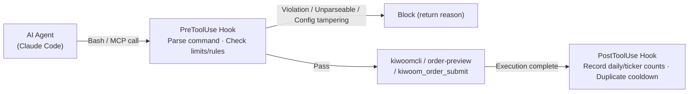

# kiwoom-order-guard Detailed Guide

[← Back to README](../README.en.md)

## Contents

- [Why It Exists](#why-it-exists)
- [Inspection Rule Details](#inspection-rule-details)
- [Inspected Order Paths](#inspected-order-paths)
- [Limitations in Detail](#limitations-in-detail)
- [CLI Commands (`kog`)](#cli-commands-kog)
- [Development](#development)

## Why It Exists

In Aug–Sep 2026, Kiwoom released an official MCP server (`Kiwoom-REST-API/mcp_exec`) and Claude Code plugin (`Kiwoom-Plugin`).
Both guard the order **path**: order tools are disabled by default, follow preview → human confirmation → submit, and require explicit approval for live accounts.
Neither inspects the order **contents**. As noted in the official server code:

> confirm can be set by the caller (an AI included). Human approval relies on the client's
> tool-execution approval or a future plugin hook.
> — `mcp_exec/src/kiwoom_exec_mcp/server.py`

When an agent proposes orders and a human repeatedly clicks "Approve", confirmation becomes a habit.
This hook catches the orders that habit misses.



## Inspection Rule Details

See the [README](../README.en.md#inspection-rules--defaults) for the default limits table.

- **Sells** are exempt from amount/quantity caps, count limits, and duplicate checks so liquidation during sharp drops is never blocked. Set `apply_caps_to_sell` to cap sells as well.
  **Cancels** reduce risk and pass through.
- **Orders are matched by command structure, not executable name.** After unquoting, it looks for `orders <write-cmd> … --confirm` and `order-preview`, so `$KW`, `ki''woomcli`, and `python -m kiwoom_cli` all undergo the same inspection.
- **Unparseable orders are blocked**, including:
  - Orders using stock names or variables (`$C`), or abbreviated flags (`--mark`)
  - Orders inside loops, functions, `xargs`, `watch`, or `find -exec`
  - Orders wrapped in `bash -c "…"`, `$( )`, or quotes
  The agent receives a reason instructing it to run with explicit ticker codes, one order at a time.
  Writing script files containing orders (`.sh`, `.py`, `.ps1`, etc.) is also blocked.
- **Counts only track executed calls.** Recording happens in `PostToolUse`, so orders rejected by the human at the permission prompt are not counted.
  If a single call contains multiple orders, each earlier order is counted before evaluating the next.

## Inspected Order Paths

Input shapes are taken directly from official specifications.

| Path | When Inspected | Source |
|---|---|---|
| Plugin `python -m kw_runtime.cli order-preview …` | When creating the order preview (submission only accepts preview ID) | `Kiwoom-Plugin` `skills/kiwoom-order/SKILL.md`, `kw_runtime/cli.py` |
| `kiwoomcli domestic\|overseas orders <buy\|sell\|modify\|cancel\|credit-*\|gold-*> … --confirm`, `overseas exchange request --confirm` | When `--confirm` is present | kwcli 1.0.3 `maps/arguments.csv`, `api_commands.csv` (17 `order_write` types) |
| MCP `kiwoom_order_submit(command_path, options, confirm)` | When `confirm` is not falsy | `mcp_exec/.../server.py` |

When the official plugin is installed, direct `kiwoomcli … --confirm` calls are already blocked by the official `prod_guard`.
Inspection on that path matters when using only the MCP server or kwcli without the plugin.

## Limitations in Detail

This hook is a seatbelt, not a vault.

- **Calls bypassing hooks.** The following are not seen:
  - Running an already-existing script file (`bash o.sh`) — only writing new scripts is blocked
  - Agent calling REST APIs directly from Python
  - Direct `POST` requests to the plugin runtime HTTP endpoint
  - Manual orders clicked by a human in the Trading Surface UI
- **Outside Claude Code.** Hooks only run in Claude Code; MCP calls from Claude Desktop, Codex, or Cursor pass through.
  The official plugin docs note the same limitation.
- **When the hook fails to start.** Without `uv` or Python 3.13, Claude Code passes failed hooks through rather than blocking.
  The official plugin behaves the same way.
- **Cannot guarantee prevention of guard tampering.** Access to config/state directories, `kog resume`, disabling the plugin, and `disableAllHooks` are blocked,
  but string matching can be worked around by a determined agent. Account-level limits remain the true last line of defense.
- **No market-price checks.** Previous close, price-limit bands, and deviation from current price are not in v0.1;
  they will not be added until quote response fields are verified against the live server.
- **No risky-disclosure filtering.** Blocking halted, managed, or same-day rights-offering/CB-disclosure stocks is planned for the next release.
- **When config cannot be read.** If the config file has a typo or is missing, buys and modifies are blocked, while cancels and sells pass through.
  The blocklist is not applied in this state.
- **Fail-safe false positives.** Order examples written inside heredoc documents are parsed and inspected as orders.
  Text-only commands such as `grep`, `echo`, `cat`, and `git` are exempted.
- **Untested on real Windows hardware.** Only UTF-8 stdin reading has been verified in tests (simulating a cp949 locale).

## CLI Commands (`kog`)

| Command | Description |
|---|---|
| `kog init` / `kog config` | Create default config / Show config path and contents |
| `kog status` | Today's buy attempt count and emergency stop state |
| `kog stop` / `kog resume` | Enable / clear emergency stop (`resume` cannot be run by an agent) |
| `kog check '<cmd>'` | Dry-run inspection of a single Bash command (no recording) |

## Development

```bash
uv sync
uv run pytest -q
```
