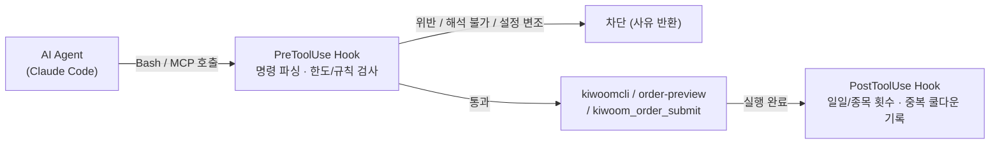

# kiwoom-order-guard 상세 가이드

[← README로 돌아가기](../README.md)

## 목차

- [왜 필요한가](#왜-필요한가)
- [검사 규칙 세부 사항](#검사-규칙-세부-사항)
- [검사하는 주문 경로](#검사하는-주문-경로)
- [못 막는 것 상세](#못-막는-것-상세)
- [명령 (`kog`)](#명령-kog)
- [개발](#개발)

## 왜 필요한가

키움은 2026-08~09 에 공식 MCP 서버(`Kiwoom-REST-API/mcp_exec`)와 Claude Code 플러그인(`Kiwoom-Plugin`)을 냈다.
둘 다 주문 **경로**를 지킨다: 주문 도구는 기본으로 꺼져 있고, 프리뷰 → 사람 확인 → 전송 순서를 거치며, 실전 계좌는 명시적으로 승인해야 한다.
주문 **내용**을 보는 곳은 없다. 공식 서버 코드의 주석 그대로:

> confirm can be set by the caller (an AI included). Human approval relies on the client's
> tool-execution approval or a future plugin hook.
> — `mcp_exec/src/kiwoom_exec_mcp/server.py`

에이전트가 주문을 제안하고 사람이 "확인"을 누르는 일이 반복되면 확인은 습관이 된다.
이 훅은 그 습관이 놓치는 주문을 잡는다.



## 검사 규칙 세부 사항

기본 한도 표는 [README](../README.md#검사-규칙과-기본값)에 있다.

- **매도**는 급락 때 청산을 막지 않도록 금액·수량 상한, 횟수, 반복 검사에서 뺀다. 상한까지 걸려면 `apply_caps_to_sell`.
  **취소**는 위험을 줄이므로 통과한다.
- **주문은 실행 파일 이름이 아니라 명령 구조로 찾는다.** 따옴표를 푼 뒤 `orders <쓰기명령> … --confirm`·`order-preview` 를 찾으므로
  `$KW`, `ki''woomcli`, `python -m kiwoom_cli` 로 불러도 같은 검사를 받는다.
- **해석 못 하는 주문은 막는다.** 다음 주문이 그렇다:
  - 종목을 이름이나 변수(`$C`)로 쓴 주문, 줄임 플래그(`--mark`)를 쓴 주문
  - 반복문·함수·`xargs`·`watch`·`find -exec` 안의 주문
  - `bash -c "…"`·`$( )`·따옴표 안에 감싼 주문
  에이전트에게는 "코드로, 한 건씩, 그대로 실행하라"는 사유가 돌아간다.
  주문이 든 스크립트 파일(`.sh`·`.py`·`.ps1` 등)을 쓰는 것도 막는다.
- **횟수는 실제로 실행된 호출만 센다.** 기록은 PostToolUse 에서 한다. 권한 창에서 사람이 거부한 주문은 세지 않는다.
  한 호출에 주문이 여럿이면 앞 주문을 센 뒤 다음 주문을 판정한다.

## 검사하는 주문 경로

입력 모양은 공식 자료에서 그대로 가져왔다.

| 경로 | 언제 검사하나 | 출처 |
|---|---|---|
| 플러그인 `python -m kw_runtime.cli order-preview …` | 주문표를 만들 때 (전송은 주문표 ID 만 받는다) | `Kiwoom-Plugin` `skills/kiwoom-order/SKILL.md`, `kw_runtime/cli.py` |
| `kiwoomcli domestic\|overseas orders <buy\|sell\|modify\|cancel\|credit-*\|gold-*> … --confirm`, `overseas exchange request --confirm` | `--confirm` 이 있을 때 | kwcli 1.0.3 `maps/arguments.csv`, `api_commands.csv` (order_write 17종) |
| MCP `kiwoom_order_submit(command_path, options, confirm)` | `confirm` 이 거짓이 아닐 때 | `mcp_exec/.../server.py` |

공식 플러그인이 깔려 있으면 `kiwoomcli … --confirm` 직접 전송은 공식 `prod_guard` 가 이미 막는다.
그 경로의 검사가 의미 있는 것은 MCP 서버만 쓰거나 플러그인 없이 kwcli 를 쓸 때다.

## 못 막는 것 상세

이 훅은 안전벨트지 금고가 아니다.

- **훅을 거치지 않는 호출.** 다음 주문은 보지 않는다.
  - 이미 있는 스크립트 파일을 실행하는 주문(`bash o.sh`) — 새로 쓰는 것만 막는다
  - 에이전트가 파이썬으로 REST 를 직접 부르는 주문
  - 플러그인 런타임 HTTP 에 직접 `POST` 하는 주문
  - 사람이 Trading Surface 화면에서 직접 누른 주문
- **Claude Code 밖.** 훅은 Claude Code 에서만 돈다. Claude Desktop·Codex·Cursor 의 MCP 호출은 지나간다.
  공식 플러그인 문서도 같은 한계를 적어 두었다.
- **훅이 아예 못 뜰 때.** `uv` 나 Python 3.13 이 없으면 Claude Code 는 실패한 훅을 막지 않고 통과시킨다.
  공식 플러그인도 같다.
- **가드 끄기를 끝까지 막지는 못한다.** 설정 폴더·상태 폴더 경로, `kog resume`, 플러그인 비활성화, `disableAllHooks` 는 막는다.
  하지만 글자 맞추기라서 마음먹은 에이전트는 돌아갈 수 있다. 진짜 마지막 줄은 계좌 쪽 한도다.
- **시세 기준 검사가 없다.** 전일 종가·가격제한폭·현재가 대비 괴리는 v0.1 에 없다.
  시세 응답 필드를 실서버에서 확인하기 전에는 코드에 넣지 않는다.
- **위험 공시 종목을 걸러내지 않는다.** 거래정지·관리종목·당일 유상증자·CB 공시 종목 차단은 다음 판에서 한다.
- **설정을 못 읽을 때.** 설정 파일에 오타가 있거나 파일이 사라지면 매수·정정은 막지만, 취소·매도는 통과시킨다.
  이때는 차단 목록도 적용되지 않는다.
- **안전한 쪽으로 틀리는 오탐.** heredoc 으로 쓰는 문서 안의 주문 예시도 주문으로 해석해 검사한다.
  `grep`·`echo`·`cat`·`git` 같은 글자만 다루는 명령은 예외다.
- **Windows 는 실기에서 돌려 보지 않았다.** stdin 을 UTF-8 로 읽는 것만 테스트로 확인했다(cp949 로케일 흉내).

## 명령 (`kog`)

| 명령 | 하는 일 |
|---|---|
| `kog init` / `kog config` | 기본 설정 만들기 / 위치·내용 보기 |
| `kog status` | 오늘 매수 시도 횟수, 비상정지 여부 |
| `kog stop` / `kog resume` | 비상정지 켜기 / 풀기 (`resume` 은 에이전트가 못 한다) |
| `kog check '<명령>'` | Bash 명령 하나를 판정만 해 본다(기록 안 함) |

## 개발

```bash
uv sync
uv run pytest -q
```
